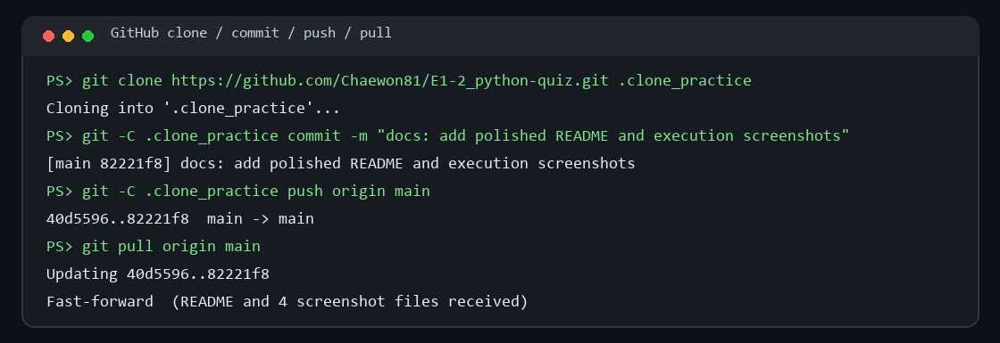

# 🧠 Python 콘솔 퀴즈 게임

말장난 문제를 즐기는 4지선다 콘솔 게임입니다. 현재 `state.json`에는 말장난 퀴즈 10개가 들어 있으며, 문제를 추가하거나 삭제할 수도 있습니다. 저장 파일이 없거나 복구할 수 없을 때 쓰는 기본 퀴즈는 Python 주제 5개입니다. 최고 점수와 플레이 기록은 JSON 파일에 저장되어 다음 실행에도 이어집니다.

> Python 3.10+ · 외부 Python 패키지 없이 실행 · UTF-8 JSON 저장

## 실행 화면

메뉴와 현재 등록된 퀴즈를 확인합니다.


문제 순서를 섞어 출제하고, 선택한 문제 수만큼 플레이합니다.


최고 점수와 최근 플레이 기록을 확인할 수 있습니다.


Git 커밋과 기능 브랜치 병합 이력도 함께 관리했습니다.


별도 clone에서 수정·push한 뒤 원본에서 pull한 과정입니다.



## 빠른 시작

저장소를 복제한 뒤 프로젝트 폴더에서 실행합니다.

```bash
git clone https://github.com/Chaewon81/E1-2_python-quiz.git
cd E1-2_python-quiz
python main.py
```

Python 3.10 이상이 필요합니다. 별도의 패키지 설치는 필요하지 않습니다.

## 메뉴와 기능

| 메뉴 | 기능 |
| --- | --- |
| 퀴즈 풀기 | 문제 순서를 무작위로 섞고 풀 문제 수를 선택합니다. 정답이면 문제별 배점을 획득합니다. |
| 퀴즈 추가 | 질문, 선택지 4개, 정답, 분류, 배점을 입력해 저장합니다. |
| 퀴즈 목록 | 등록된 문제의 분류와 배점을 확인합니다. |
| 점수 확인 | 최고 점수와 최근 10회의 점수·날짜를 확인합니다. |
| 퀴즈 삭제 | 목록에서 번호를 골라 문제를 삭제합니다. |
| 종료 | 저장 후 프로그램을 종료합니다. |

숫자 입력은 공백을 제거하고 값과 범위를 확인합니다. 빈 값이나 문자가 입력되면 안내 후 다시 입력받습니다. `Ctrl+C` 또는 입력 종료(EOF) 시 저장을 시도한 뒤 안전하게 종료합니다.

| 입력 상황 | 처리 |
| --- | --- |
| 공백 또는 문자 | 정수 변환 오류를 안내하고 다시 입력 |
| 메뉴·정답 번호의 범위 초과 | 허용 범위를 안내하고 다시 입력 |
| `Ctrl+C` 또는 EOF | 현재 데이터를 저장하고 종료 |

## 데이터 저장 형식

프로젝트 루트의 `state.json`에 퀴즈, 최고 점수, 플레이 기록을 저장합니다.

```json
{
  "quizzes": [
    {
      "question": "파이썬에서 여러 값을 순서대로 저장하는 자료형은?",
      "choices": ["dict", "list", "set", "int"],
      "answer": 2,
      "points": 10,
      "category": "Python"
    }
  ],
  "best_score": 10,
  "score_history": [
    {"date": "2026-11-13T10:00:00+09:00", "score": 10, "question_count": 1}
  ]
}
```

| 필드 | 자료형 | 조건 |
| --- | --- | --- |
| `quizzes` | list of object | 비어 있지 않은 퀴즈 목록 |
| `question` | string | 공백이 아닌 문제 |
| `choices` | list of string | 비어 있지 않은 선택지 4개 |
| `answer` | int | 정답 번호 1~4 |
| `points` | int | 정답 배점, 1 이상 (생략 시 10) |
| `category` | string | 분류, 비어 있지 않은 값 (생략 시 `일반`) |
| `best_score` | int | 최고 점수, 0 이상 |
| `score_history` | list of object | 각 기록에 문자열 `date`, 0 이상 정수 `score`, 0 이상 정수 `question_count` 포함 |

`json.dump(..., ensure_ascii=False, indent=2)`에서 `ensure_ascii=False`는 한글을 그대로 읽을 수 있게 하고, `indent=2`는 파일을 사람이 읽고 비교하기 쉽게 합니다. 이전 형식처럼 `points`나 `category`가 없는 퀴즈도 기본값으로 읽습니다.

### 저장의 한계와 복구

JSON은 작은 로컬 퀴즈 데이터에 적합하지만, 파일 전체를 메모리에 읽고 저장할 때마다 전체 내용을 다시 쓰므로 데이터가 커질수록 메모리와 디스크 작업이 늘어납니다. 현재처럼 퀴즈 10개와 소량의 기록에는 충분합니다. 여러 사용자가 동시에 쓰거나 기록이 매우 많아지는 서비스라면 SQLite 같은 데이터베이스를 고려합니다.

저장할 때 기존 `state.json`이 유효하면 직전 정상본을 `state.json.bak`으로 보존한 뒤 임시 파일을 본 파일로 교체합니다. 본 파일이 손상됐으면 백업에서 데이터를 복구하고, 백업도 없거나 손상된 경우 기본 퀴즈로 시작합니다. 이 백업은 한 세대만 보존하므로 장기 보관이 필요하면 `state.json.bak`을 별도 위치에도 복사하세요.

## 코드 구성

```text
.
├── main.py             # 시작점과 중단 입력 처리
├── quiz.py             # Quiz 데이터, 검증, JSON 변환
├── quiz_game.py        # 메뉴, 게임 흐름, 파일 저장/불러오기
├── state.json          # 퀴즈와 점수 데이터
├── study.md            # 미션 핵심 개념 학습 노트
└── docs/screenshots/   # 실행 및 Git 이력 캡처
```

| 클래스/파일 | 주요 메서드 | 책임 |
| --- | --- | --- |
| `Quiz` (`quiz.py`) | `display()`, `check_answer()`, `to_dict()`, `from_dict()` | 문제 한 개의 데이터 검증, 출력, 정답 판정과 JSON 변환 |
| `QuizGame` (`quiz_game.py`) | `run()`, `play_quiz()`, `add_quiz()`, `delete_quiz()`, `load_state()`, `save_state()` | 메뉴, 퀴즈 목록, 점수, 게임 흐름과 파일 입출력 |
| `main()` (`main.py`) | `main()` | 게임 생성·시작과 Ctrl+C/EOF 안전 종료 |

객체지향 구조는 문제 데이터와 게임 운영 상태를 한데 섞지 않아 역할과 책임을 찾기 쉽습니다. 작은 일회성 스크립트라면 함수만으로도 충분하지만, 기능이 늘고 여러 데이터가 함께 움직일 때 클래스가 상태와 관련 동작을 묶어 관리하기 편합니다.

## Git 작업 이력

기능은 `feature/quiz-play` 브랜치에서 개발한 뒤 `main`에 병합했습니다. 커밋 10개 이상, 병합, clone/pull 이력을 저장소에서 확인할 수 있습니다.

- 저장소: [Chaewon81/E1-2_python-quiz](https://github.com/Chaewon81/E1-2_python-quiz)
- 커밋 목록: [main 브랜치 커밋 기록](https://github.com/Chaewon81/E1-2_python-quiz/commits/main/)
- 병합과 커밋 그래프: 위 `git-history.png`
- clone → 수정/커밋/push → 원본 pull: 위 `clone-pull.png`

```bash
git log --oneline --graph
git clone https://github.com/Chaewon81/E1-2_python-quiz.git
git pull origin main
```

## 학습 자료

프로젝트에서 사용한 변수와 자료형, 조건문과 반복문, 함수, 클래스, 예외 처리, JSON, Git 개념은 [`study.md`](study.md)에 정리했습니다.
