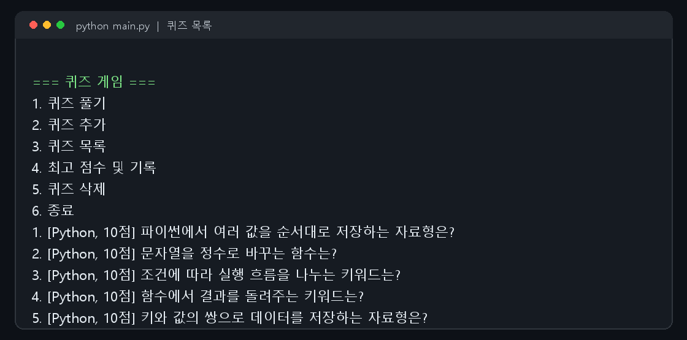
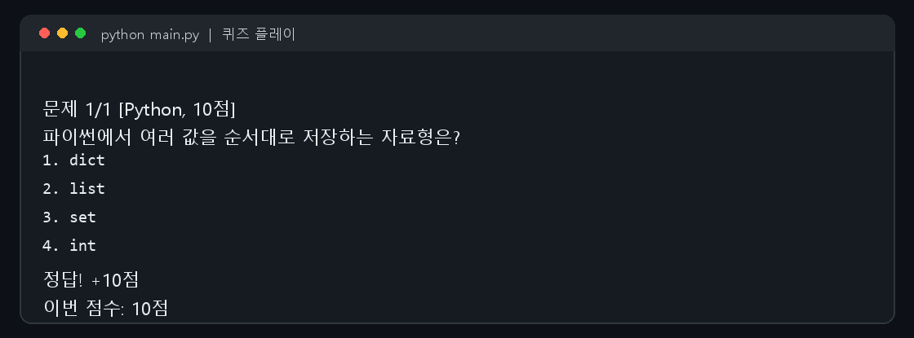
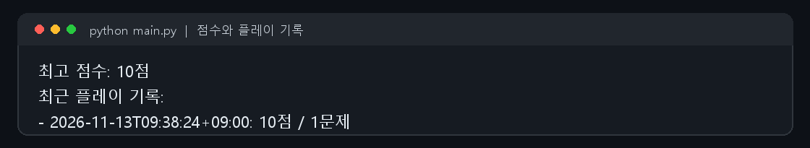
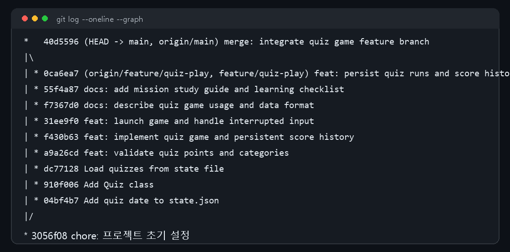

# 🧠 Python 콘솔 퀴즈 게임

Python 기초를 퀴즈로 익히는 4지선다 콘솔 게임입니다. 퀴즈를 풀고 직접 문제를 추가하거나 삭제할 수 있으며, 최고 점수와 플레이 기록은 JSON 파일에 저장되어 다음 실행에도 이어집니다.

> Python 3.10+ · 외부 Python 패키지 없이 실행 · UTF-8 JSON 저장

## 실행 화면

메뉴와 현재 등록된 퀴즈를 확인합니다.



문제 순서를 섞어 출제하고, 선택한 문제 수만큼 플레이합니다.



최고 점수와 최근 플레이 기록을 확인할 수 있습니다.



Git 커밋과 기능 브랜치 병합 이력도 함께 관리했습니다.



## 빠른 시작

저장소를 복제한 뒤 프로젝트 폴더에서 실행합니다.

```bash
git clone https://github.com/Chaewon81/E1-2_python-quiz.git
cd E1-2_python-quiz
python main.py
```

Python 3.10 이상이 필요합니다. 별도의 패키지 설치는 필요하지 않습니다.

## 메뉴와 기능

| 메뉴 | 기능 |
| --- | --- |
| 퀴즈 풀기 | 문제 순서를 무작위로 섞고 풀 문제 수를 선택합니다. 정답이면 문제별 배점을 획득합니다. |
| 퀴즈 추가 | 질문, 선택지 4개, 정답, 분류, 배점을 입력해 저장합니다. |
| 퀴즈 목록 | 등록된 문제의 분류와 배점을 확인합니다. |
| 점수 확인 | 최고 점수와 최근 10회의 점수·날짜를 확인합니다. |
| 퀴즈 삭제 | 목록에서 번호를 골라 문제를 삭제합니다. |
| 종료 | 저장 후 프로그램을 종료합니다. |

숫자 입력은 공백을 제거하고 값과 범위를 확인합니다. 빈 값이나 문자가 입력되면 안내 후 다시 입력받습니다. `Ctrl+C` 또는 입력 종료(EOF) 시 저장을 시도한 뒤 안전하게 종료합니다.

## 데이터 저장 형식

프로젝트 루트의 `state.json`에 퀴즈, 최고 점수, 플레이 기록을 저장합니다.

```json
{
  "quizzes": [
    {
      "question": "파이썬에서 여러 값을 순서대로 저장하는 자료형은?",
      "choices": ["dict", "list", "set", "int"],
      "answer": 2,
      "points": 10,
      "category": "Python"
    }
  ],
  "best_score": 10,
  "score_history": [
    {"date": "2026-11-13T10:00:00+09:00", "score": 10, "question_count": 1}
  ]
}
```

`answer`는 선택지 번호(1~4)이며, `points`는 정답일 때 얻는 점수입니다. 이전 형식처럼 `points` 또는 `category`가 없는 문제는 각각 10점과 `일반` 분류를 적용해 불러옵니다. 저장 파일이 없거나 올바른 JSON이 아니면 기본 퀴즈로 시작합니다.

## 코드 구성

```text
.
├── main.py             # 시작점과 중단 입력 처리
├── quiz.py             # Quiz 데이터, 검증, JSON 변환
├── quiz_game.py        # 메뉴, 게임 흐름, 파일 저장/불러오기
├── state.json          # 퀴즈와 점수 데이터
├── study.md            # 미션 핵심 개념 학습 노트
└── docs/screenshots/   # 실행 및 Git 이력 캡처
```

`Quiz`는 문제 한 개의 데이터와 정답 판정을 담당하고, `QuizGame`은 문제 목록, 점수, 메뉴, 영속 저장을 관리합니다. JSON 저장 시 객체를 딕셔너리로 변환하고, 불러올 때 `Quiz` 객체로 복원합니다.

## Git 작업 이력

기능은 `feature/quiz-play` 브랜치에서 개발한 뒤 `main`에 병합했습니다. 저장소에는 의미 있는 커밋 10개 이상과 clone/pull 실습 이력이 있습니다.

```bash
git log --oneline --graph
git pull origin main
```

## 학습 자료

프로젝트에서 사용한 변수와 자료형, 조건문과 반복문, 함수, 클래스, 예외 처리, JSON, Git 개념은 [`study.md`](study.md)에 정리했습니다.
